<!-- このファイルは scripts/rule-examples.mjs が docs/rule-examples/examples.json から生成する。直接編集しない -->

# Rule examples

This page shows how each rule changes text, with one image per rule. Every image is generated from the output of the real `jafix` binary for the example text. See [Rules](./rules.md) for each rule's kind and default state.

## How to read the images {#legend}

From top to bottom, an image shows the rule ID and kind, the example text, and what the rule does. Each example runs with only that rule enabled. When an example changes an option, the configuration follows the image.

- A `Fix` image has two rows, `Before` and `After`. A red background marks characters the fix removes, and a green background marks characters it inserts
- A `Report` image has the example text only. A red background marks the reported words
- An open box stands for a space, which would otherwise be invisible
- A frame such as `U+200B` stands for a character that is not displayed. It shows the code point of the character
- `↵` is a line break
- The bottom line describes the rule and gives the number of findings. `jafix check` itself prints its messages in Japanese

## jafix-specific fixes {#jafix}

### `fullwidth-paren` {#fullwidth-paren}

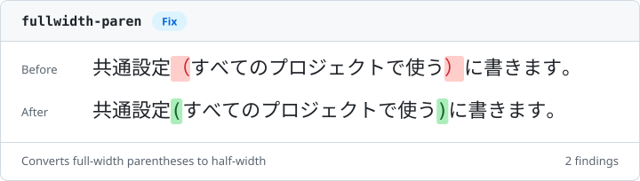

### `space-between-ja-and-alnum` {#space-between-ja-and-alnum}

Spaces between English words stay.

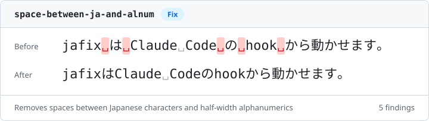

### `space-between-ja-and-paren` {#space-between-ja-and-paren}

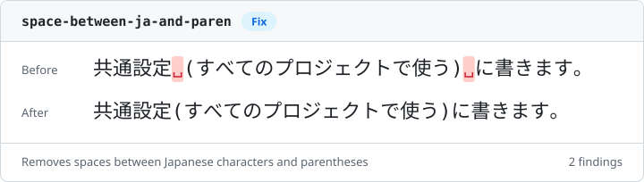

## Japanese technical writing {#technical-writing}

### `sentence-length` {#sentence-length}

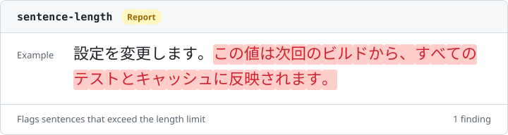

This example uses the following configuration.

```toml
[builtin]
sentence-length = { max = 30 }
```

### `max-comma` {#max-comma}

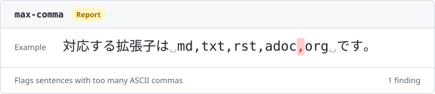

### `max-kanji-continuous-len` {#max-kanji-continuous-len}

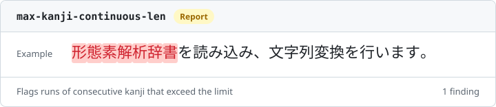

### `arabic-kanji-numbers` {#arabic-kanji-numbers}

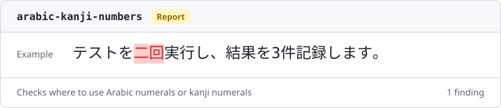

### `ja-no-mixed-period` {#ja-no-mixed-period}

List items are not reported even without a period.

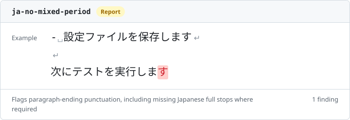

### `no-nfd` {#no-nfd}

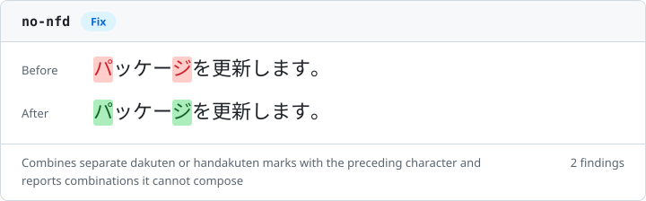

### `no-invalid-control-character` {#no-invalid-control-character}

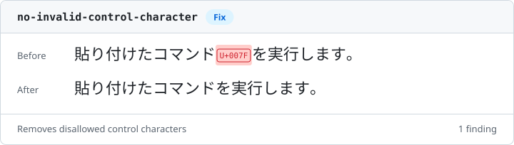

### `no-zero-width-spaces` {#no-zero-width-spaces}

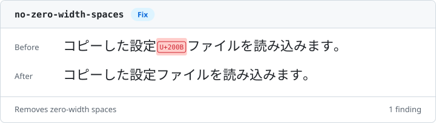

### `no-exclamation-question-mark` {#no-exclamation-question-mark}

A question mark inside a URL is not reported.

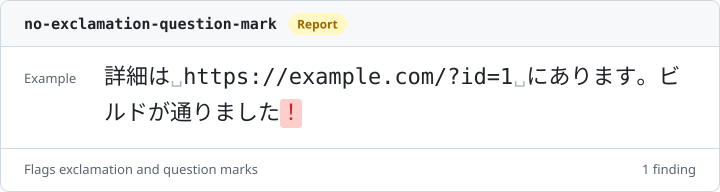

### `no-hankaku-kana` {#no-hankaku-kana}

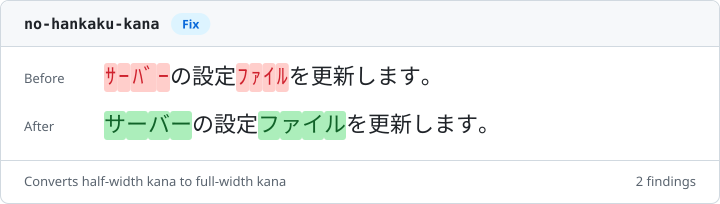

### `ja-unnatural-alphabet` {#ja-unnatural-alphabet}

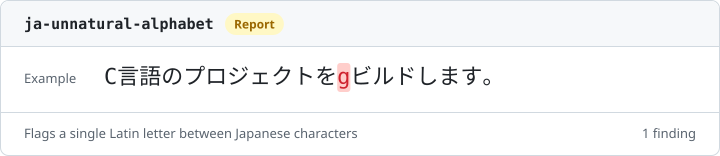

### `no-unmatched-pair` {#no-unmatched-pair}

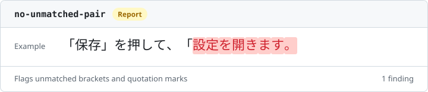

### `max-ten` {#max-ten}

Commas that separate a list of nouns are not counted.

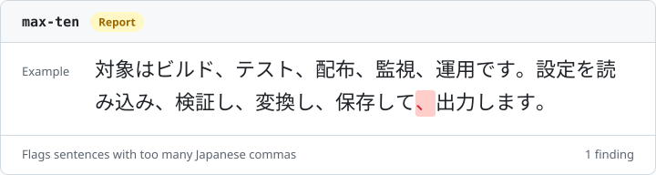

### `no-doubled-joshi` {#no-doubled-joshi}

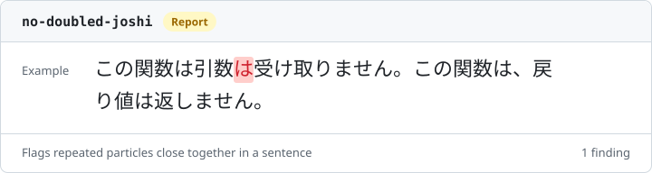

### `no-doubled-conjunctive-particle-ga` {#no-doubled-conjunctive-particle-ga}

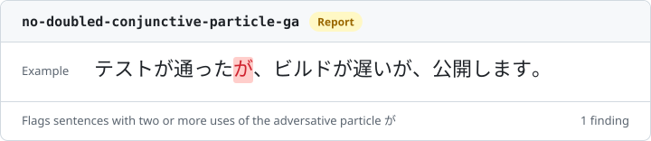

### `no-doubled-conjunction` {#no-doubled-conjunction}

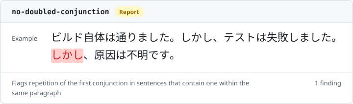

### `no-mix-dearu-desumasu` {#no-mix-dearu-desumasu}

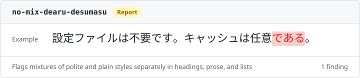

### `no-double-negative-ja` {#no-double-negative-ja}

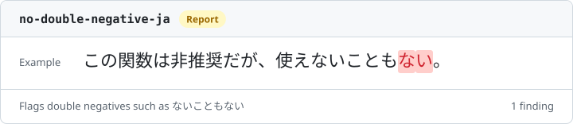

### `no-dropping-the-ra` {#no-dropping-the-ra}

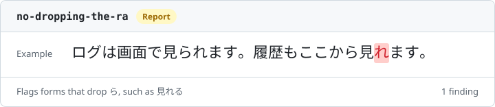

### `ja-no-weak-phrase` {#ja-no-weak-phrase}

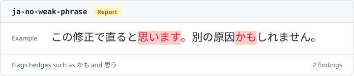

### `ja-no-successive-word` {#ja-no-successive-word}

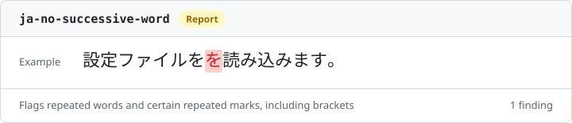

### `ja-no-abusage` {#ja-no-abusage}

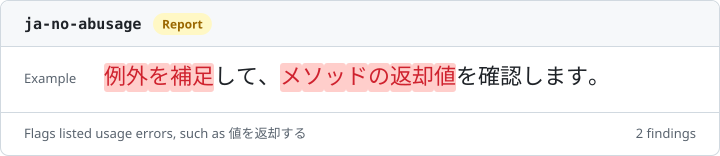

### `ja-no-redundant-expression` {#ja-no-redundant-expression}

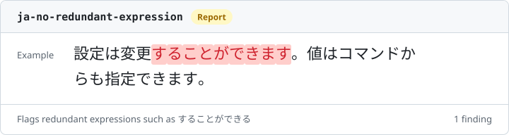

## Patterns common in AI writing {#ai-writing}

### `no-ai-list-formatting` {#no-ai-list-formatting}

A bold item with no colon after it is not reported.

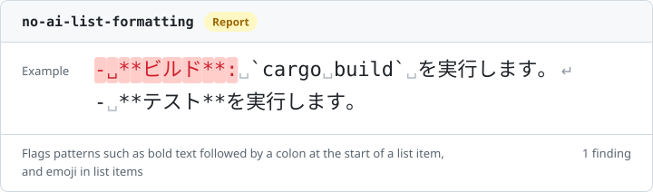

### `no-ai-hype-expressions` {#no-ai-hype-expressions}

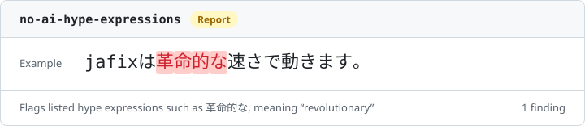

### `no-ai-emphasis-patterns` {#no-ai-emphasis-patterns}

Bold text without an emoji is not reported.

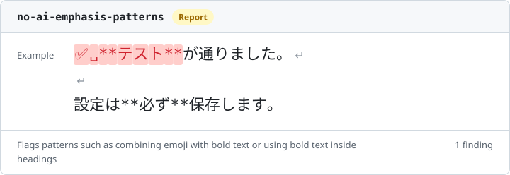

### `no-ai-colon-continuation` {#no-ai-colon-continuation}

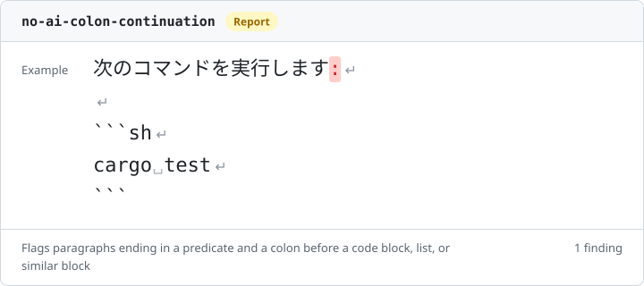

### `ai-tech-writing-guideline` {#ai-tech-writing-guideline}

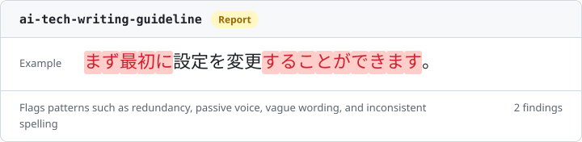

### `no-ai-words` {#no-ai-words}

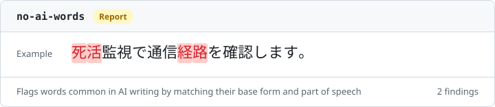

### `no-short-topic-comma` {#no-short-topic-comma}

A topic of six characters or more is not reported.

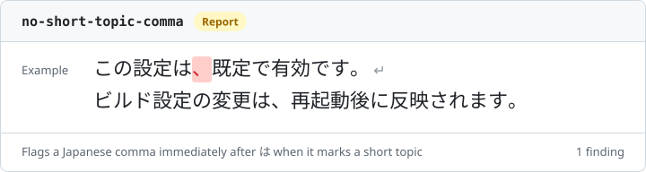

## Rules adapted from yomiyasu {#yomiyasu}

### `yomiyasu-bold-not-rendered` {#yomiyasu-bold-not-rendered}

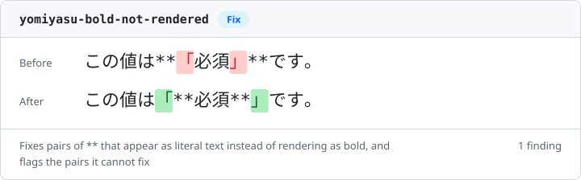

### `yomiyasu-instruction-residue` {#yomiyasu-instruction-residue}

An exclusion followed by a link to where the topic is covered is not reported.

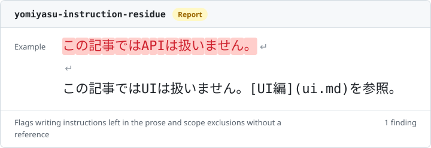

### `yomiyasu-chat-response` {#yomiyasu-chat-response}

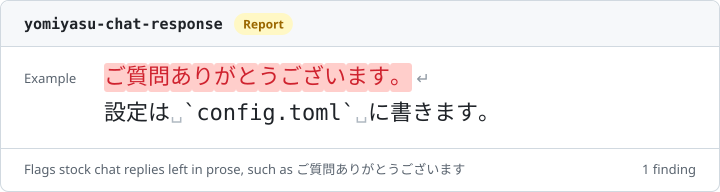

### `yomiyasu-meta-filler` {#yomiyasu-meta-filler}

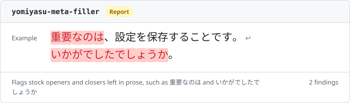

### `yomiyasu-summary-restatement` {#yomiyasu-summary-restatement}

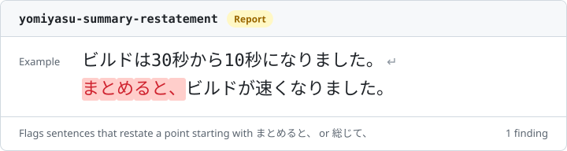

### `yomiyasu-meta-intro` {#yomiyasu-meta-intro}

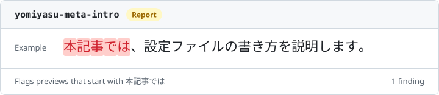

### `yomiyasu-count-declaration` {#yomiyasu-count-declaration}

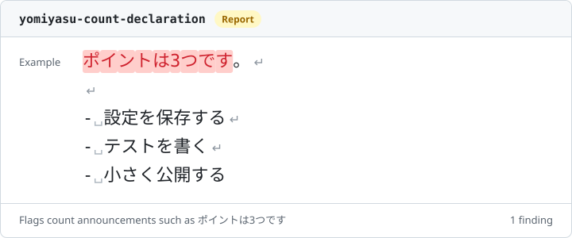

### `yomiyasu-ai-phrase` {#yomiyasu-ai-phrase}

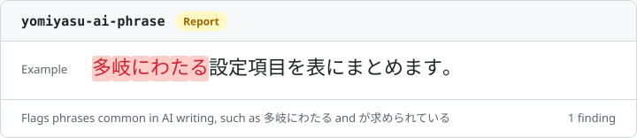

### `yomiyasu-placeholder-residue` {#yomiyasu-placeholder-residue}

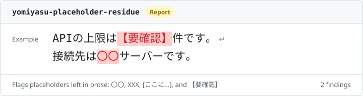

### `yomiyasu-short-mochiron` {#yomiyasu-short-mochiron}

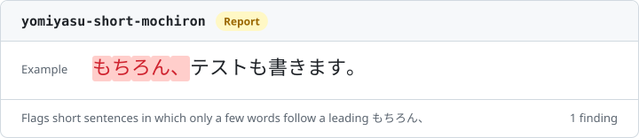

### `yomiyasu-say-hedge` {#yomiyasu-say-hedge}

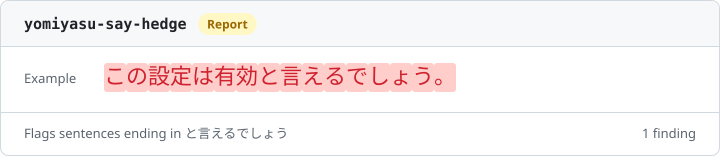

### `yomiyasu-fragment-run` {#yomiyasu-fragment-run}

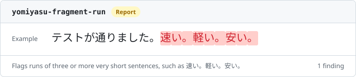

### `yomiyasu-cleft-list-ending` {#yomiyasu-cleft-list-ending}

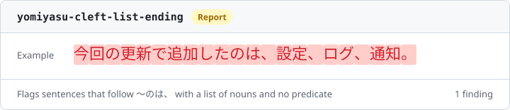

### `yomiyasu-copy-comma-noun` {#yomiyasu-copy-comma-noun}

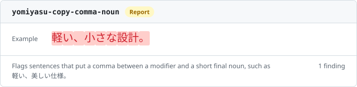

### `yomiyasu-bare-verb-chain` {#yomiyasu-bare-verb-chain}

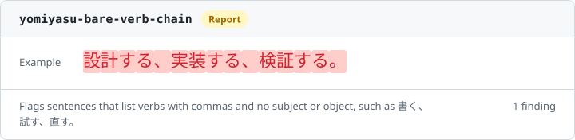

### `yomiyasu-dash-decoration` {#yomiyasu-dash-decoration}

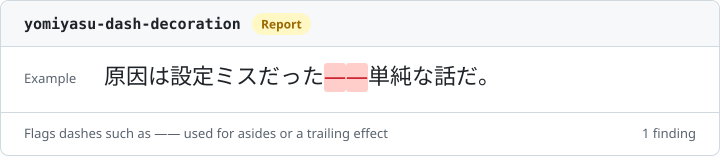

### `yomiyasu-dash-insertion` {#yomiyasu-dash-insertion}

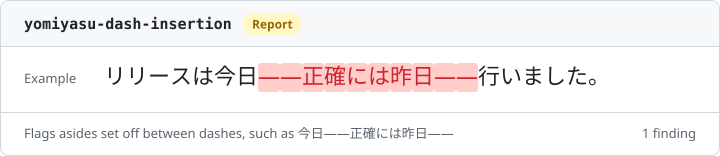

### `yomiyasu-dash-list-ending` {#yomiyasu-dash-list-ending}


### `yomiyasu-emoji-prohibited` {#yomiyasu-emoji-prohibited}


### `yomiyasu-renyo-noun` {#yomiyasu-renyo-noun}


### `yomiyasu-slop-vocabulary` {#yomiyasu-slop-vocabulary}


### `yomiyasu-katakana-term` {#yomiyasu-katakana-term}


## Spacing and character forms {#spacing}

### `ja-nakaguro-or-halfwidth-space-between-katakana` {#ja-nakaguro-or-halfwidth-space-between-katakana}


### `ja-no-space-around-parentheses` {#ja-no-space-around-parentheses}

Half-width round brackets are not checked.


### `ja-no-space-around-slash` {#ja-no-space-around-slash}


### `ja-no-space-between-full-width` {#ja-no-space-between-full-width}


### `ja-space-between-half-and-full-width` {#ja-space-between-half-and-full-width}

Spaces between English words stay.


### `ja-space-after-exclamation` {#ja-space-after-exclamation}


### `ja-space-after-question` {#ja-space-after-question}


### `ja-space-around-code` {#ja-space-around-code}


### `ja-space-around-emphasis` {#ja-space-around-emphasis}


### `ja-space-around-link` {#ja-space-around-link}


### `ja-space-around-strong` {#ja-space-around-strong}


### `no-mixed-zenkaku-and-hankaku-alphabet` {#no-mixed-zenkaku-and-hankaku-alphabet}


### `no-kangxi-radicals` {#no-kangxi-radicals}

The two characters look the same but have different code points.


## Japanese translation style guide: prose style and punctuation {#jtf-prose}

### `1.1.1.本文` {#1.1.1}

The less common style is the one reported.


### `1.1.2.見出し` {#1.1.2}


### `1.1.3.箇条書き` {#1.1.3}


### `1.1.5.図表のキャプション` {#1.1.5}


### `1.2.1.句点(。)と読点(、)` {#1.2.1}


### `1.2.2.ピリオド(.)とカンマ(,)` {#1.2.2}


## Japanese translation style guide: characters and terms {#jtf-characters}

### `2.1.2.漢字` {#2.1.2}


### `2.1.5.カタカナ` {#2.1.5}


### `2.1.6.カタカナの長音` {#2.1.6}


### `2.1.8.算用数字` {#2.1.8}


### `2.1.9.アルファベット` {#2.1.9}


### `2.1.10.算用数字の位取りの表記` {#2.1.10}

A comma that separates thousands is not reported.


### `2.2.1.ひらがなと漢字の使い分け` {#2.2.1}


### `2.2.2.算用数字と漢数字の使い分け` {#2.2.2}


### `2.2.3.一部の助数詞の表記` {#2.2.3}


## Japanese translation style guide: spacing {#jtf-spacing}

### `3.1.1.全角文字と半角文字の間` {#3.1.1}

Spaces between English words stay.


### `3.1.2.全角文字どうし` {#3.1.2}


### `3.2.カタカナ語間のスペースの有無` {#3.2}


### `3.3.かっこ類と隣接する文字の間のスペースの有無` {#3.3}

Unless the setting is changed, spaces outside half-width round brackets stay.


## Japanese translation style guide: symbols and brackets {#jtf-punctuation}

### `4.1.1.句点(。)` {#4.1.1}

A period outside the brackets is not reported.


### `4.1.3.ピリオド(.)、カンマ(,)` {#4.1.3}


### `4.2.1.感嘆符(！)` {#4.2.1}

An exclamation mark right after English is not reported.


### `4.2.2.疑問符(？)` {#4.2.2}

A question mark right after English is not reported.


### `4.2.4.中黒(・)` {#4.2.4}


### `4.2.5.波線(〜)` {#4.2.5}


### `4.2.6.ハイフン(-)` {#4.2.6}

A hyphen that joins alphanumeric characters is not reported.


### `4.2.7.コロン(：)` {#4.2.7}

A colon inside a URL is not reported.


### `4.2.8.セミコロン(;)` {#4.2.8}


### `4.2.9.ダッシュ(-)` {#4.2.9}


### `4.3.1.丸かっこ（）` {#4.3.1}


### `4.3.2.大かっこ［］` {#4.3.2}


### `4.3.3.かぎかっこ「」` {#4.3.3}

Paired brackets are not reported, only the opening bracket that is never closed.


### `4.3.4.二重かぎかっこ『』` {#4.3.4}

Paired brackets are not reported, only the opening bracket that is never closed.


### `4.3.5.二重引用符` {#4.3.5}

Only when the number of quotation marks is odd, the unpaired one is reported.


### `4.3.6.中かっこ{ }` {#4.3.6}

Paired braces are not reported, only the opening brace that is never closed.


### `4.3.7.山かっこ<>` {#4.3.7}

Arrows and comparison operators are not counted as angle brackets.


## Hiragana, forms with `さ`, and synonyms {#japanese-wording}

### `ja-hiragana-hojodoushi` {#ja-hiragana-hojodoushi}

A main verb such as `頂きました` is not reported.


### `ja-hiragana-keishikimeishi` {#ja-hiragana-keishikimeishi}


### `ja-keishikimeishi` {#ja-keishikimeishi}

The report for `うえ` is turned off by the setting, so `上` is not reported.


This example uses the following configuration.

```toml
[builtin]
ja-keishikimeishi = { detection_ue = false }
```

### `ja-hiragana-fukushi` {#ja-hiragana-fukushi}


### `ja-hiragana-daimeishi` {#ja-hiragana-daimeishi}


### `@textlint-ja/no-insert-dropping-sa` {#textlint-ja-no-insert-dropping-sa}


### `@textlint-ja/no-synonyms` {#textlint-ja-no-synonyms}


## Language-independent checks {#general}

### `no-todo` {#no-todo}

A completed task is not reported.


### `date-weekday-mismatch` {#date-weekday-mismatch}

A date whose weekday is correct is not reported.


## English spelling and style {#english}

### `terminology` {#terminology}

A word that only the built-in dictionary matches is reported and left as it is.


This example uses the following configuration.

```toml
[builtin]
terminology = { terms = [['front[- ]end(\w*)', 'frontend$1']] }
```

### `spelling` {#spelling}


### `common-misspellings` {#common-misspellings}


### `write-good` {#write-good}


## Custom replacements and filters {#custom-rules-and-filters}

### `prh` {#prh}


This example uses the following configuration.

```toml
[builtin]
prh = { ruleContents = ['''
rules:
  - expected: 利用者
    pattern: /ユーザー?/
'''] }
```

### `@textlint-rule/pattern` {#textlint-rule-pattern}

A date without a year does not match the pattern, so it stays.


This example uses the following configuration.

```toml
[builtin]
"@textlint-rule/pattern" = { patterns = [{ message = "日付はYYYY-MM-DDで書く", pattern = '/(\d{4})/(\d{2})/(\d{2})/', replace = "$1-$2-$3" }] }
```

## Rules without an example {#skipped}

The following rules have no image because a single example text cannot show them.

- `4.3.8.一重引用符`: This rule only exists so that the preset key can be written in a configuration, and it reports nothing for any text.
- `no-dead-link`: The rule that checks link targets does not apply to text from standard input, and the example text is passed through standard input, so it can report nothing.
