<!-- このファイルは scripts/rule-examples.mjs が docs/rule-examples/examples.json から生成する。直接編集しない -->

# ルールの例

このページは、ルールが文章をどう変えるかを、ルールごとの画像で示します。画像は、例文を実際の `jafix` に渡した結果から作っています。ルールの種類と初期状態は[ルール一覧](./rules.md)で確認できます。

## 画像の見方 {#legend}

画像は、上から順に、ルールIDと種類、例文、指摘の文面を示します。例文には、そのルールだけを有効にした設定を使っています。オプションを変えた例には、その設定を添えています。

- 種類が「修正」の画像は、修正前と修正後の2行です。赤い背景は修正で消える文字、緑の背景は修正で入る文字です
- 種類が「指摘」の画像は、例文だけです。赤い背景は、指摘の対象の語句です
- 底の開いた箱の形は、空白です。空白は見えないので、形に置き換えています
- `U+200B` のような枠は、表示されない文字です。枠の中は、その文字のコードポイントです
- `↵` は改行です
- 下の段は、`jafix check` が出す文面と、指摘の数です

## jafix独自の修正 {#jafix}

### `fullwidth-paren` {#fullwidth-paren}

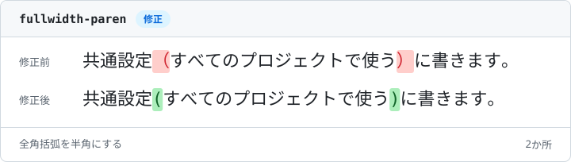

### `space-between-ja-and-alnum` {#space-between-ja-and-alnum}

英単語の間の空白は残します。

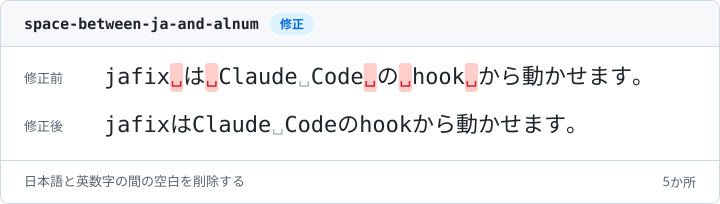

### `space-between-ja-and-paren` {#space-between-ja-and-paren}

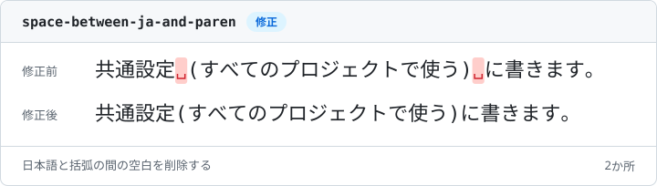

## 日本語の技術文書 {#technical-writing}

### `sentence-length` {#sentence-length}

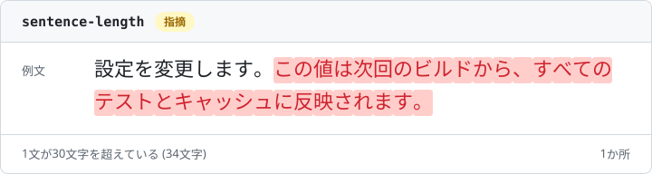

この例の設定は、次のとおりです。

```toml
[builtin]
sentence-length = { max = 30 }
```

### `max-comma` {#max-comma}

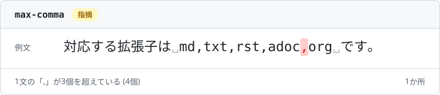

### `max-kanji-continuous-len` {#max-kanji-continuous-len}

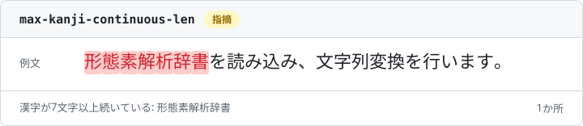

### `arabic-kanji-numbers` {#arabic-kanji-numbers}

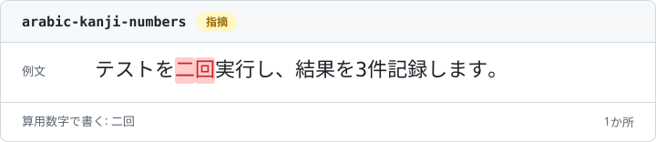

### `ja-no-mixed-period` {#ja-no-mixed-period}

箇条書きの項目は、句点がなくても指摘しません。

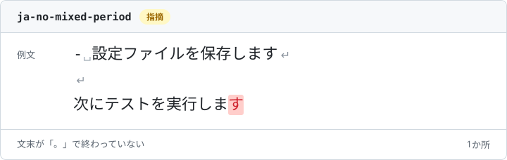

### `no-nfd` {#no-nfd}

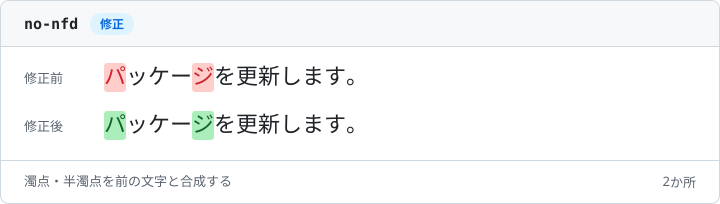

### `no-invalid-control-character` {#no-invalid-control-character}

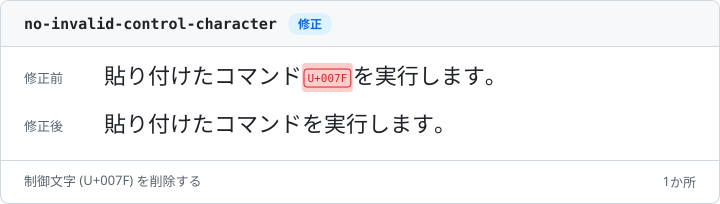

### `no-zero-width-spaces` {#no-zero-width-spaces}

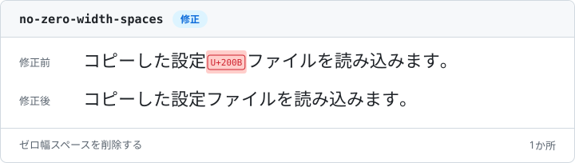

### `no-exclamation-question-mark` {#no-exclamation-question-mark}

URLの中の疑問符は指摘しません。

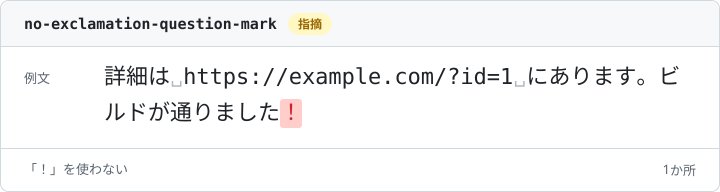

### `no-hankaku-kana` {#no-hankaku-kana}

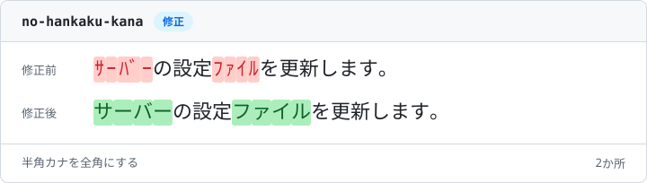

### `ja-unnatural-alphabet` {#ja-unnatural-alphabet}

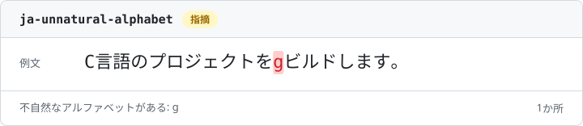

### `no-unmatched-pair` {#no-unmatched-pair}

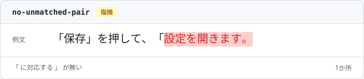

### `max-ten` {#max-ten}

名詞を並べる読点は数えません。

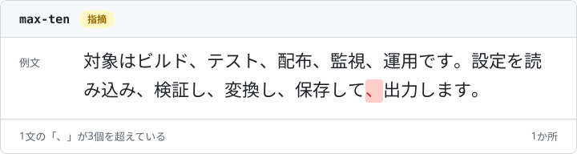

### `no-doubled-joshi` {#no-doubled-joshi}

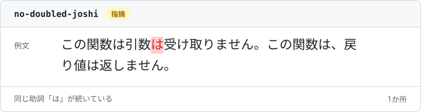

### `no-doubled-conjunctive-particle-ga` {#no-doubled-conjunctive-particle-ga}

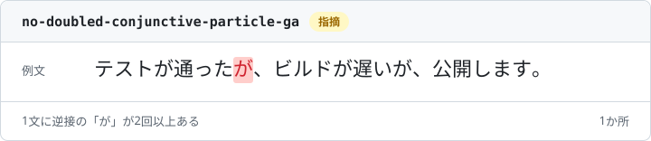

### `no-doubled-conjunction` {#no-doubled-conjunction}

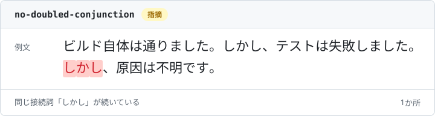

### `no-mix-dearu-desumasu` {#no-mix-dearu-desumasu}

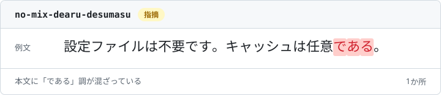

### `no-double-negative-ja` {#no-double-negative-ja}

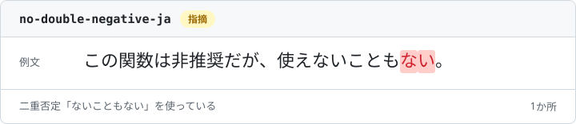

### `no-dropping-the-ra` {#no-dropping-the-ra}

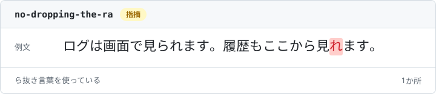

### `ja-no-weak-phrase` {#ja-no-weak-phrase}

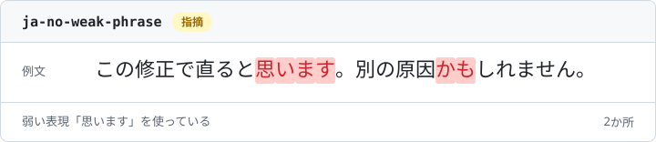

### `ja-no-successive-word` {#ja-no-successive-word}

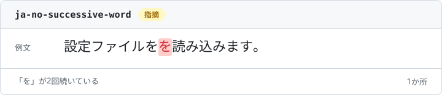

### `ja-no-abusage` {#ja-no-abusage}

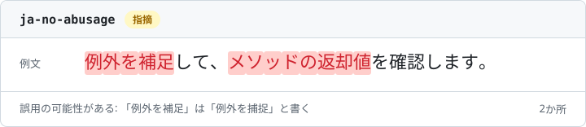

### `ja-no-redundant-expression` {#ja-no-redundant-expression}

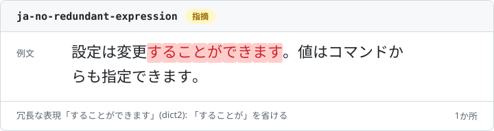

## AIが多用する書き方 {#ai-writing}

### `no-ai-list-formatting` {#no-ai-list-formatting}

太字だけで、コロンの付かない項目は指摘しません。

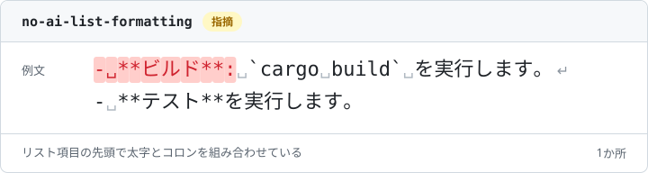

### `no-ai-hype-expressions` {#no-ai-hype-expressions}

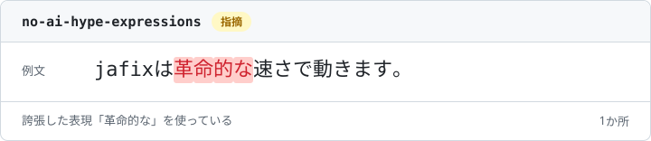

### `no-ai-emphasis-patterns` {#no-ai-emphasis-patterns}

絵文字の付かない太字は指摘しません。

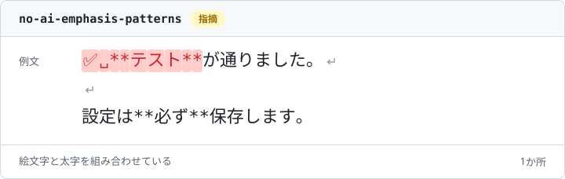

### `no-ai-colon-continuation` {#no-ai-colon-continuation}

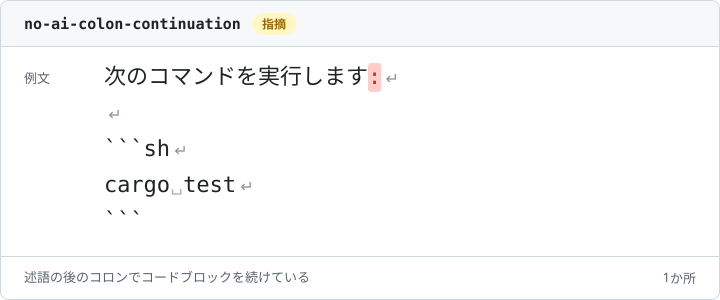

### `ai-tech-writing-guideline` {#ai-tech-writing-guideline}

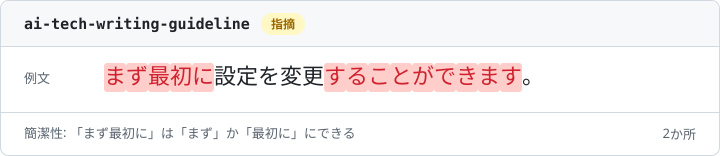

### `no-ai-words` {#no-ai-words}


### `no-short-topic-comma` {#no-short-topic-comma}

主題が6文字以上のときは指摘しません。

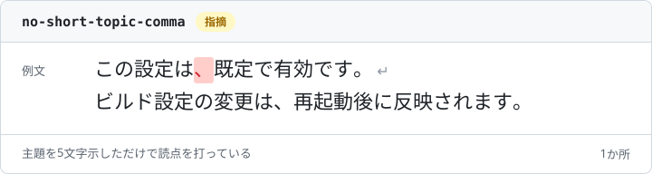

## yomiyasu由来のルール {#yomiyasu}

### `yomiyasu-bold-not-rendered` {#yomiyasu-bold-not-rendered}

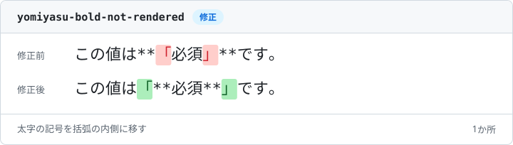

### `yomiyasu-instruction-residue` {#yomiyasu-instruction-residue}

参照先のリンクが続く除外は指摘しません。

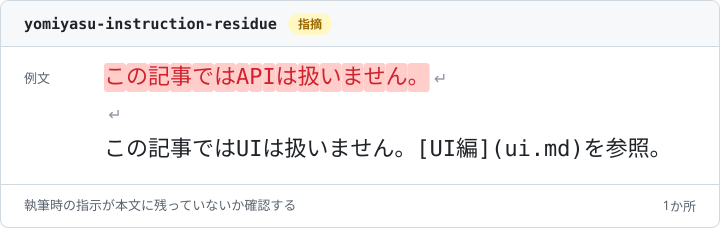

### `yomiyasu-chat-response` {#yomiyasu-chat-response}

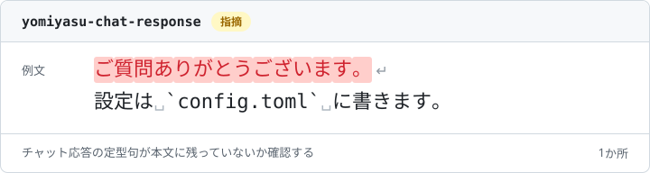

### `yomiyasu-meta-filler` {#yomiyasu-meta-filler}

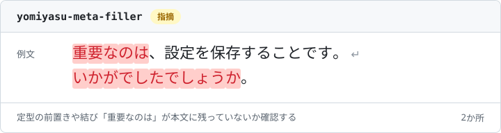

### `yomiyasu-summary-restatement` {#yomiyasu-summary-restatement}

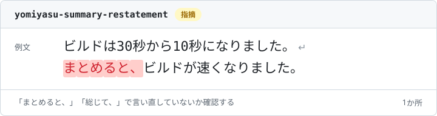

### `yomiyasu-meta-intro` {#yomiyasu-meta-intro}

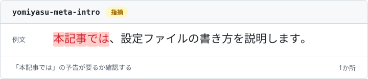

### `yomiyasu-count-declaration` {#yomiyasu-count-declaration}

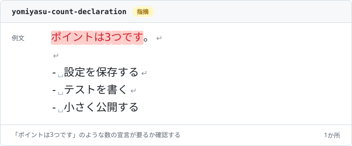

### `yomiyasu-ai-phrase` {#yomiyasu-ai-phrase}

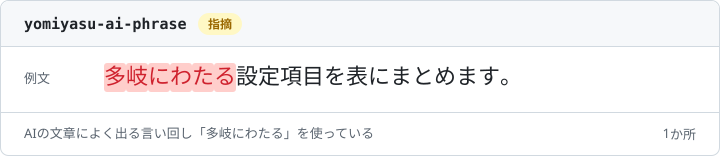

### `yomiyasu-placeholder-residue` {#yomiyasu-placeholder-residue}

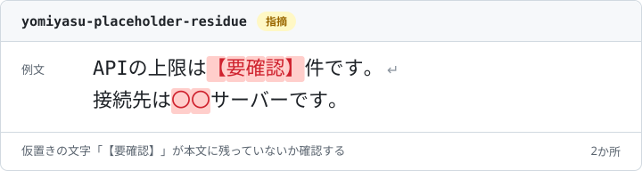

### `yomiyasu-short-mochiron` {#yomiyasu-short-mochiron}

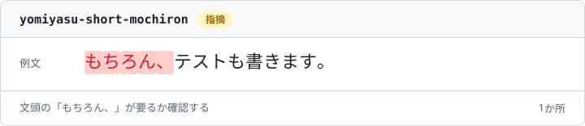

### `yomiyasu-say-hedge` {#yomiyasu-say-hedge}

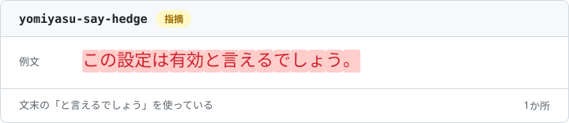

### `yomiyasu-fragment-run` {#yomiyasu-fragment-run}

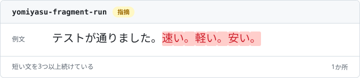

### `yomiyasu-cleft-list-ending` {#yomiyasu-cleft-list-ending}

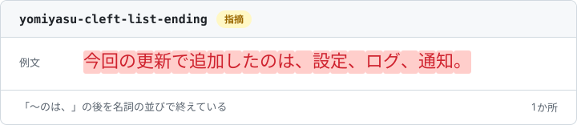

### `yomiyasu-copy-comma-noun` {#yomiyasu-copy-comma-noun}

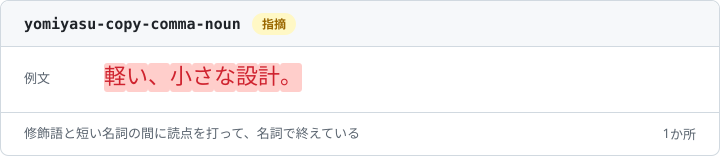

### `yomiyasu-bare-verb-chain` {#yomiyasu-bare-verb-chain}

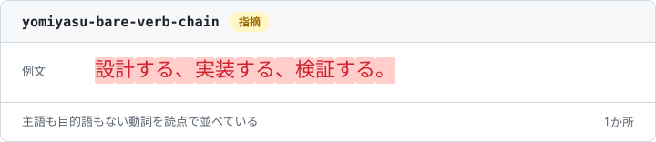

### `yomiyasu-dash-decoration` {#yomiyasu-dash-decoration}

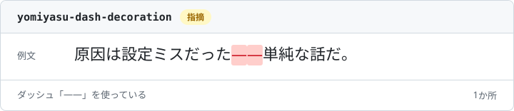

### `yomiyasu-dash-insertion` {#yomiyasu-dash-insertion}

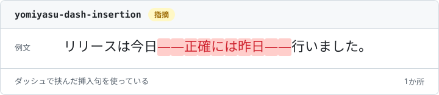

### `yomiyasu-dash-list-ending` {#yomiyasu-dash-list-ending}

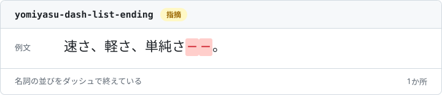

### `yomiyasu-emoji-prohibited` {#yomiyasu-emoji-prohibited}


### `yomiyasu-renyo-noun` {#yomiyasu-renyo-noun}


### `yomiyasu-slop-vocabulary` {#yomiyasu-slop-vocabulary}


### `yomiyasu-katakana-term` {#yomiyasu-katakana-term}


## 空白と字種 {#spacing}

### `ja-nakaguro-or-halfwidth-space-between-katakana` {#ja-nakaguro-or-halfwidth-space-between-katakana}


### `ja-no-space-around-parentheses` {#ja-no-space-around-parentheses}

半角の丸括弧は対象にしません。


### `ja-no-space-around-slash` {#ja-no-space-around-slash}


### `ja-no-space-between-full-width` {#ja-no-space-between-full-width}


### `ja-space-between-half-and-full-width` {#ja-space-between-half-and-full-width}

英単語の間の空白は残します。


### `ja-space-after-exclamation` {#ja-space-after-exclamation}


### `ja-space-after-question` {#ja-space-after-question}


### `ja-space-around-code` {#ja-space-around-code}


### `ja-space-around-emphasis` {#ja-space-around-emphasis}


### `ja-space-around-link` {#ja-space-around-link}


### `ja-space-around-strong` {#ja-space-around-strong}


### `no-mixed-zenkaku-and-hankaku-alphabet` {#no-mixed-zenkaku-and-hankaku-alphabet}


### `no-kangxi-radicals` {#no-kangxi-radicals}

見た目は同じでも、文字のコードは別です。


## 日本語標準スタイルガイド: 文体と句読点 {#jtf-prose}

### `1.1.1.本文` {#1.1.1}

少ないほうの文体を指摘します。


### `1.1.2.見出し` {#1.1.2}


### `1.1.3.箇条書き` {#1.1.3}


### `1.1.5.図表のキャプション` {#1.1.5}


### `1.2.1.句点(。)と読点(、)` {#1.2.1}


### `1.2.2.ピリオド(.)とカンマ(,)` {#1.2.2}


## 日本語標準スタイルガイド: 文字と用語の表記 {#jtf-characters}

### `2.1.2.漢字` {#2.1.2}


### `2.1.5.カタカナ` {#2.1.5}


### `2.1.6.カタカナの長音` {#2.1.6}


### `2.1.8.算用数字` {#2.1.8}


### `2.1.9.アルファベット` {#2.1.9}


### `2.1.10.算用数字の位取りの表記` {#2.1.10}

千の位の区切りのカンマは指摘しません。


### `2.2.1.ひらがなと漢字の使い分け` {#2.2.1}


### `2.2.2.算用数字と漢数字の使い分け` {#2.2.2}


### `2.2.3.一部の助数詞の表記` {#2.2.3}


## 日本語標準スタイルガイド: 空白 {#jtf-spacing}

### `3.1.1.全角文字と半角文字の間` {#3.1.1}

英単語の間の空白は残します。


### `3.1.2.全角文字どうし` {#3.1.2}


### `3.2.カタカナ語間のスペースの有無` {#3.2}


### `3.3.かっこ類と隣接する文字の間のスペースの有無` {#3.3}

設定を変えなければ、半角の丸括弧の外側の空白は残します。


## 日本語標準スタイルガイド: 記号と括弧 {#jtf-punctuation}

### `4.1.1.句点(。)` {#4.1.1}

括弧の外の句点は指摘しません。


### `4.1.3.ピリオド(.)、カンマ(,)` {#4.1.3}


### `4.2.1.感嘆符(！)` {#4.2.1}

英語の直後の感嘆符は指摘しません。


### `4.2.2.疑問符(？)` {#4.2.2}

英語の直後の疑問符は指摘しません。


### `4.2.4.中黒(・)` {#4.2.4}


### `4.2.5.波線(〜)` {#4.2.5}


### `4.2.6.ハイフン(-)` {#4.2.6}

英数字どうしをつなぐハイフンは指摘しません。


### `4.2.7.コロン(：)` {#4.2.7}

URLの中のコロンは指摘しません。


### `4.2.8.セミコロン(;)` {#4.2.8}


### `4.2.9.ダッシュ(-)` {#4.2.9}


### `4.3.1.丸かっこ（）` {#4.3.1}


### `4.3.2.大かっこ［］` {#4.3.2}


### `4.3.3.かぎかっこ「」` {#4.3.3}

対になったかぎ括弧は指摘せず、閉じていないかぎ括弧だけを指摘します。


### `4.3.4.二重かぎかっこ『』` {#4.3.4}

対になった二重かぎ括弧は指摘せず、閉じていない二重かぎ括弧だけを指摘します。


### `4.3.5.二重引用符` {#4.3.5}

引用符の数が奇数のときだけ、対にならない1つを指摘します。


### `4.3.6.中かっこ{ }` {#4.3.6}

対になった波括弧は指摘せず、閉じていない波括弧だけを指摘します。


### `4.3.7.山かっこ<>` {#4.3.7}

矢印や比較の記号は、山かっことして数えません。


## ひらがな、さ入れ言葉、同義語 {#japanese-wording}

### `ja-hiragana-hojodoushi` {#ja-hiragana-hojodoushi}

補助動詞ではない「頂きました」は指摘しません。


### `ja-hiragana-keishikimeishi` {#ja-hiragana-keishikimeishi}


### `ja-keishikimeishi` {#ja-keishikimeishi}

「うえ」の指摘は設定で外しているので、「上」は指摘しません。


この例の設定は、次のとおりです。

```toml
[builtin]
ja-keishikimeishi = { detection_ue = false }
```

### `ja-hiragana-fukushi` {#ja-hiragana-fukushi}


### `ja-hiragana-daimeishi` {#ja-hiragana-daimeishi}


### `@textlint-ja/no-insert-dropping-sa` {#textlint-ja-no-insert-dropping-sa}


### `@textlint-ja/no-synonyms` {#textlint-ja-no-synonyms}


## 言語を問わない確認 {#general}

### `no-todo` {#no-todo}

完了したタスクは指摘しません。


### `date-weekday-mismatch` {#date-weekday-mismatch}

曜日が合う日付は指摘しません。


## 英語の綴りと表現 {#english}

### `terminology` {#terminology}

組み込みの辞書だけに当たる語は、直さずに指摘だけを出します。


この例の設定は、次のとおりです。

```toml
[builtin]
terminology = { terms = [['front[- ]end(\w*)', 'frontend$1']] }
```

### `spelling` {#spelling}


### `common-misspellings` {#common-misspellings}


### `write-good` {#write-good}


## 利用者の置き換えとfilter {#custom-rules-and-filters}

### `prh` {#prh}


この例の設定は、次のとおりです。

```toml
[builtin]
prh = { ruleContents = ['''
rules:
  - expected: 利用者
    pattern: /ユーザー?/
'''] }
```

### `@textlint-rule/pattern` {#textlint-rule-pattern}

年の無い日付は、パターンに当たらないので直しません。


この例の設定は、次のとおりです。

```toml
[builtin]
"@textlint-rule/pattern" = { patterns = [{ message = "日付はYYYY-MM-DDで書く", pattern = '/(\d{4})/(\d{2})/(\d{2})/', replace = "$1-$2-$3" }] }
```

## 例の無いルール {#skipped}

次のルールは、1つの例文では示せないので、画像がありません。

- `4.3.8.一重引用符`: presetのキーを設定に書けるようにIDだけを持つルールで、どの例文にも指摘を出しません。
- `no-dead-link`: リンク先を調べるルールは標準入力の本文には適用されず、例文は標準入力から渡すので、指摘を出せません。
